<div align="center">

<picture>
  <source media="(prefers-color-scheme: dark)" srcset="public/img/logo-ivory.svg" />
  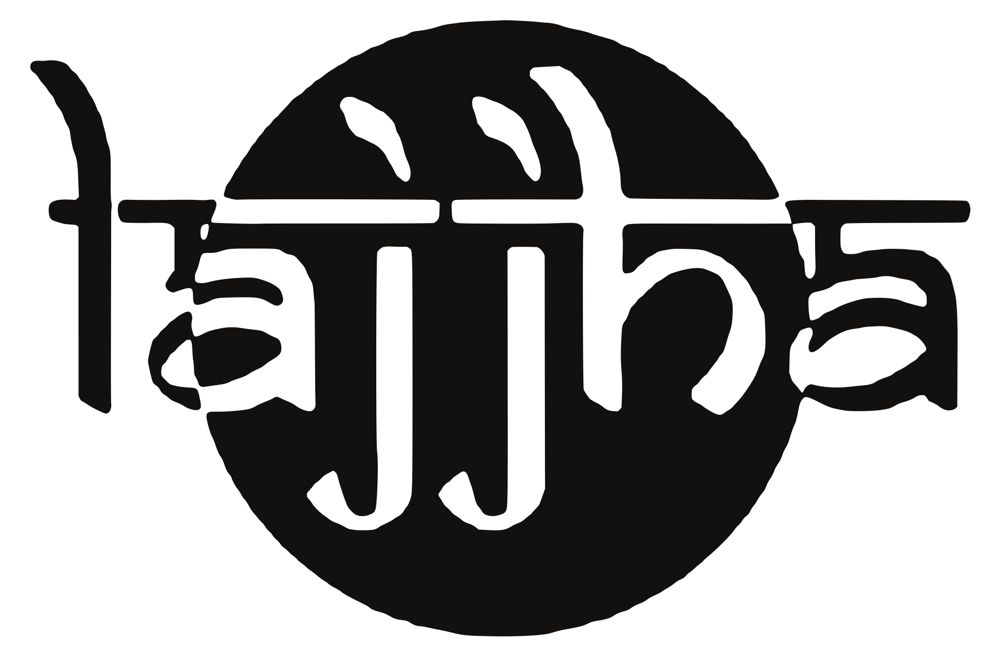
</picture>

# Lajjha · लज्जा

### Oxidised. **Not obedient.**

A storytelling landing page for a handcrafted oxidised-silver jewellery label from Siliguri.<br/>
Real-time 3D jewellery rebuilt from product photos, a scroll-driven making story, and a heritage palette turned all the way up.

<br/>


<br/>

<a href="docs/media/showcase-720p.mp4">
  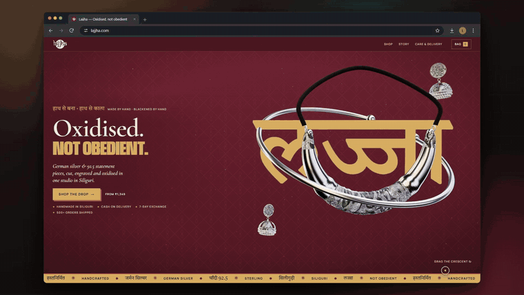
</a>

<sub>▶ The first 20 seconds, looped. <a href="docs/media/showcase-720p.mp4"><b>Watch the full 53-second walkthrough (MP4)</b></a></sub>

<!--
  INLINE VIDEO: after pushing to GitHub, drag docs/media/showcase-720p.mp4 into any issue or PR comment box,
  copy the https://github.com/user-attachments/assets/... URL it produces, and paste it alone on the line below.
  GitHub renders that URL as an inline video player.
-->

</div>

---

## Contents

- [About](#about)
- [The journey](#the-journey)
- [Design system](#design-system--heritage-turned-up)
- [How it's built](#how-its-built)
- [Tech stack](#tech-stack)
- [Project structure](#project-structure)
- [Getting started](#getting-started)

---

## About

**Lajjha** (लज्जा) means *shy*. The silver didn't get the memo.

Lajjha by Preeti Maurya makes hand-oxidised **German silver** and **92.5 sterling** statement pieces, cut, engraved and blackened in one studio in Siliguri. It was founded in 2019 and relaunched in 2026, and it sells to women aged 18–34 who wear their jewellery loud.

| | |
|---|---|
| **Positioning** | Between ₹199 zinc fast fashion and ₹20,000+ pure-silver artisans. The drop starts at ₹1,349. |
| **Voice** | Short, dry, confident, bilingual (English + Devanagari). |
| **Principles** | No fake urgency and no invented reviews. Trust facts (COD, 7-day exchange, 500+ orders) sit next to the first CTA. |

This repo is the **landing page draft**. The catalogue (names, metals, prices) mirrors the real Lajjha catalogue, but checkout is not wired up. It is *not a live store*.

<p align="center">
  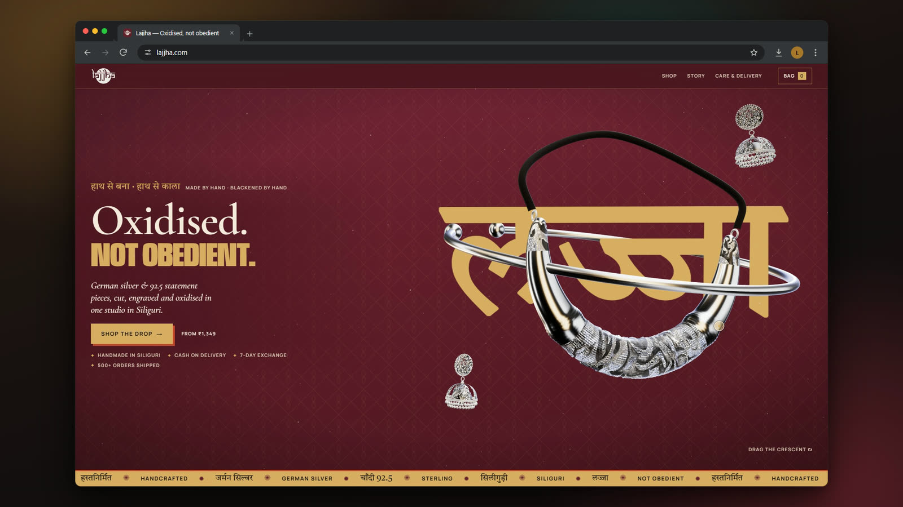
</p>

---

## The journey

Each chapter gets a whole colour block taken from the Lajjha brand guidelines. As you scroll, the WebGL background blends from one ground to the next.

| # | Chapter | Ground | What happens |
|:-:|---|---|---|
| 1 | **Hero** | Burgundy + jaal lattice | 3D gold-foil **लज्जा** with the Nira torque orbiting through it. You can drag the Ira crescent. Jhumkas float at depth in silver dust. |
| 2 | **धातु** · Metal | Royal indigo | *Two metals. Zero plating.* German silver and 92.5 side by side. |
| 3 | **शिल्प** · Craft | Peacock teal | *Made in one studio.* Scroll drives the piece through **cut → engrave → oxidise → buff**. |
| 4 | **संग्रह** · Archive | Deep emerald | *Spin the archive.* A turntable of the 3D pieces. |
| 5 | **Shop** · The drop | Lajjha ivory | 11 real pieces with metal filters. Four of them open in a **3D viewer**. |
| 6 | **मख़मल पर** · On the velvet | Ink + jaal | Instagram grid of pieces shot on velvet. |
| 7 | **Care** | Terracotta | Handmade · Cash on delivery · 7-day exchange · Care. |
| 8 | **Closer** | Burgundy | *लज्जा means shy.* Liquid-glass CTA pills. |

<table>
  <tr>
    <td width="50%">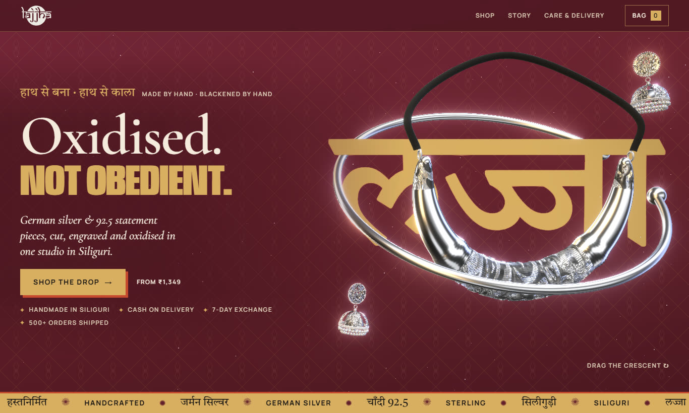<br/><sub><b>Hero</b>: Oxidised. Not obedient.</sub></td>
    <td width="50%">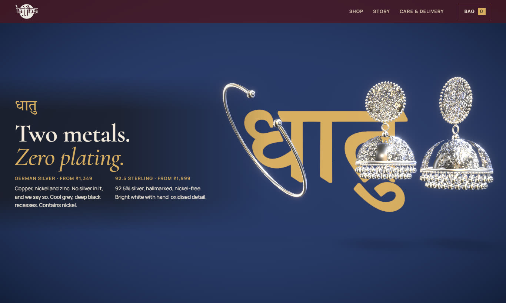<br/><sub><b>धातु</b>: two metals, zero plating</sub></td>
  </tr>
  <tr>
    <td>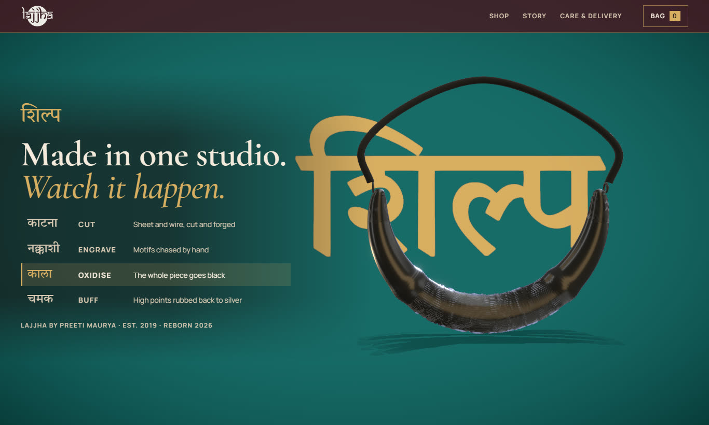<br/><sub><b>शिल्प</b>: the oxidise step, driven by scroll</sub></td>
    <td>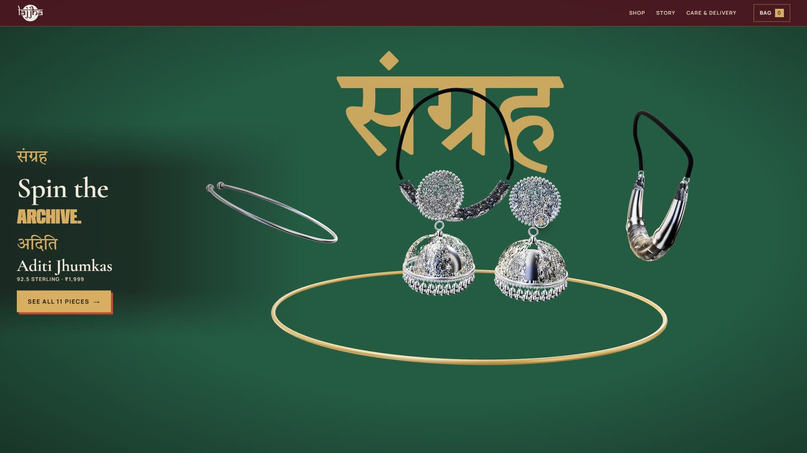<br/><sub><b>संग्रह</b>: spin the archive</sub></td>
  </tr>
  <tr>
    <td>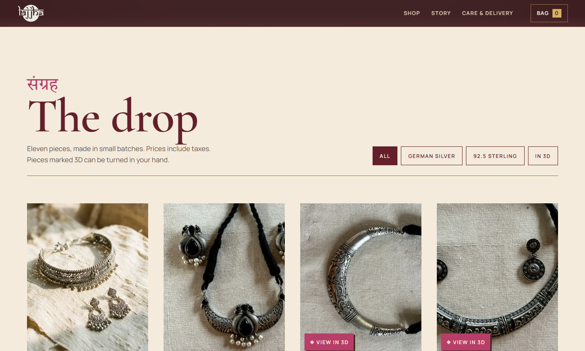<br/><sub><b>The drop</b>: real catalogue, metal filters</sub></td>
    <td>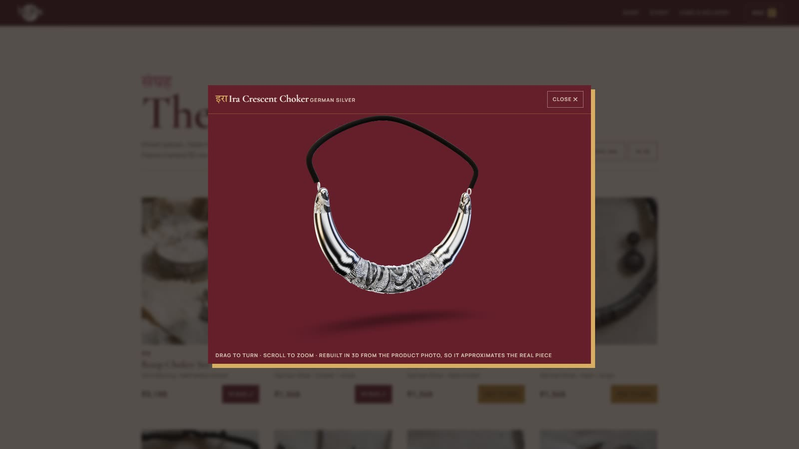<br/><sub><b>View in 3D</b>: drag to turn, scroll to zoom</sub></td>
  </tr>
  <tr>
    <td>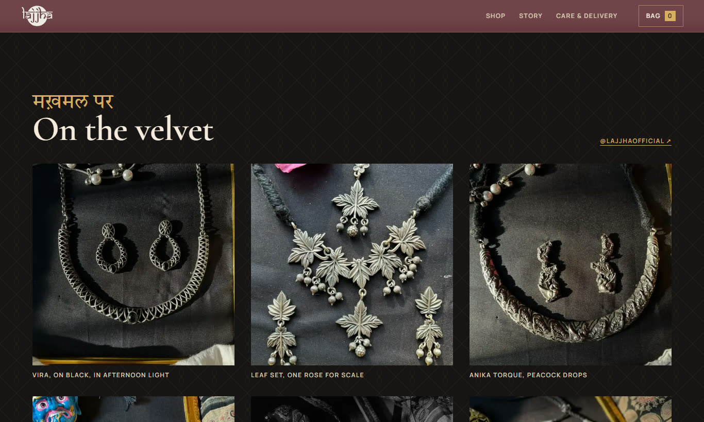<br/><sub><b>On the velvet</b>: Instagram</sub></td>
    <td>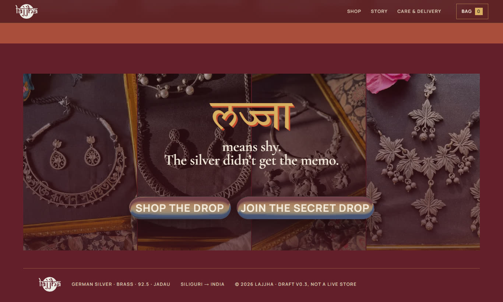<br/><sub><b>Closer</b>: liquid-glass CTA</sub></td>
  </tr>
</table>

<details>
<summary><b>The whole page on one sheet</b></summary>
<br/>
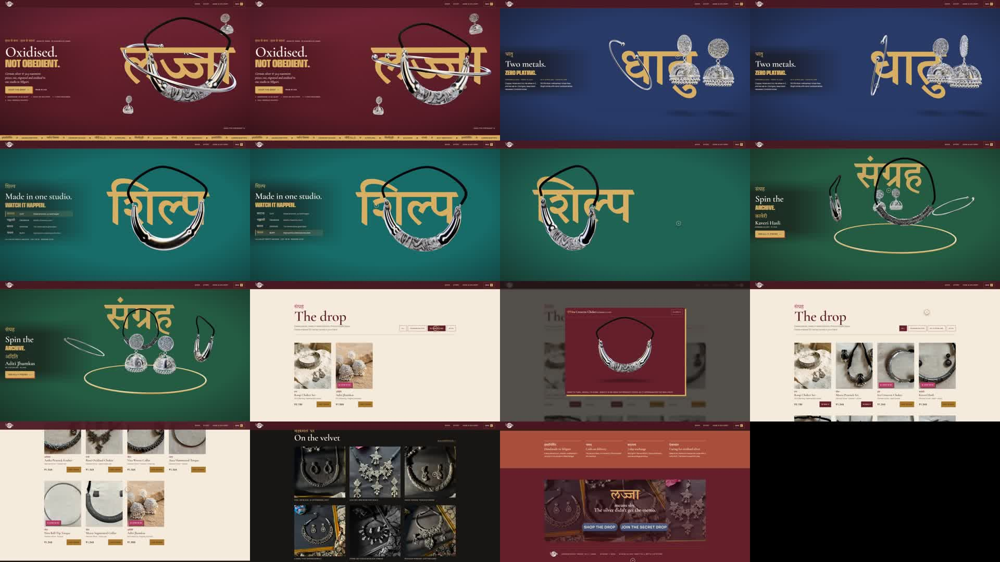
</details>

### On mobile

<table>
  <tr>
    <td align="center">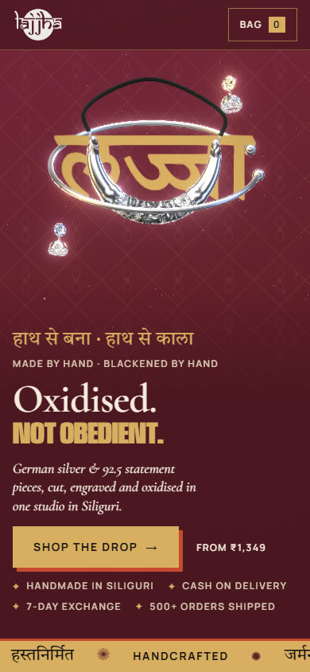</td>
    <td align="center">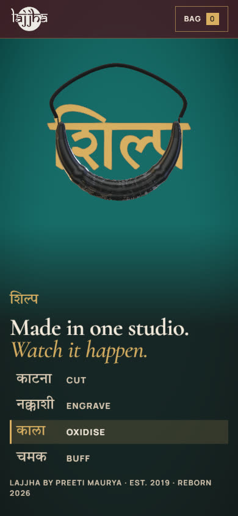</td>
    <td align="center">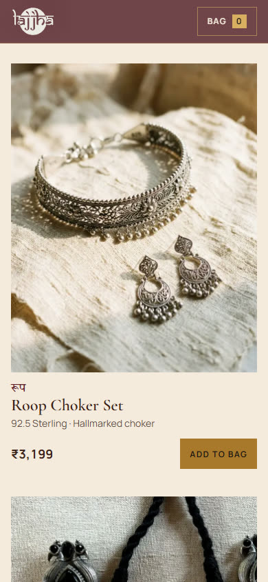</td>
  </tr>
</table>

---

## Design system: "Heritage, turned up"

> *Maximal in expression. Minimal in intention.* (Lajjha Brand Guidelines)

The guideline palette and type are used with Gen-Z energy:
- Guideline colours become **whole colour blocks**, one per chapter.
- Antique gold becomes **foil**: rules, the jaal lattice, Devanagari words, the 3D frame.
- Headlines **clash** an upright Cormorant line with a condensed gold grotesk line.
- Buttons carry a **vermilion offset shadow**.

### Colour

| | Token | Hex | Used for |
|:-:|---|---|---|
|  | `--burgundy` | `#641F2B` | Hero, closer, buttons on ivory (ivory text 10:1) |
|  | `--foil` | `#D8AE62` | Gold foil, Devanagari on dark, primary button (5.7:1 on burgundy) |
|  | `--brass` | `#A9782C` | "Add to bag" with **ink** text (4.7:1), never small text |
|  | `--indigo` | `#283A68` | धातु chapter |
|  | `--teal` | `#176B68` | शिल्प chapter |
|  | `--emerald` | `#245B43` | संग्रह chapter |
|  | `--terracotta` | `#A94E3B` | Care band |
|  | `--rani` | `#B83D6A` | "View in 3D" tag, shop Devanagari |
|  | `--vermilion` | `#C64A2F` | Offset shadows, ribbon rule, small marks |
|  | `--ivory` | `#F5EBDD` | Text on dark grounds, shop ground |
|  | `--sandstone` | `#DCCBB5` | Secondary text, image beds |
|  | `--cocoa` | `#3B211A` | Text on ivory |
|  | `--ink` | `#171414` | Instagram ground |

### Type

| Role | Face | Setting |
|---|---|---|
| Headlines | **Cormorant Garamond** SemiBold | Sentence case, line-height 0.92, large |
| Statement line | **Anybody** condensed 900 | One line per headline, uppercase, foil gold |
| Body | **Manrope** Regular | 16–18px, line-height 1.6 |
| Labels | **Manrope** SemiBold | 12px uppercase, 0.12em tracking |
| Devanagari | **Tiro Devanagari Marathi** | Chapter words, लज्जा, product names. Drawn in 3D with a faux-bold stroke |

### Do / don't

- ✅ Keep trust facts (COD, 7-day exchange, 500+ orders) next to the first CTA.
- ✅ Label the 3D models as approximate. They are rebuilt from a single photo.
- ❌ No viewer counters, "only 3 left", countdowns, fake "verified" toasts or glow effects.
- ❌ No AI models wearing jewellery Lajjha doesn't sell.

The full spec, with contrast ratios and section grounds, is in **[DESIGN.md](DESIGN.md)**.

---

## How it's built

### 1. Jewellery rebuilt from photos, procedurally

No downloaded models. The four signature pieces (**Ira**, **Kaveri**, **Nira**, **Aditi**) are procedural Three.js reconstructions in [`src/three/jewellery.js`](src/three/jewellery.js). They follow the *img2threejs* method:

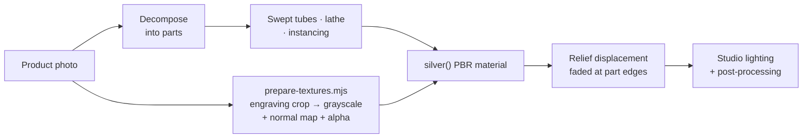

- **Engraving is projected from the photo itself.** Grayscale and normal maps are cut from the product shot. Filigree is real openwork, using the photo's alpha.
- **One material drives the story.** `silver()` is an oxidised-silver PBR material with `uEngrave`, `uOxidise` and `uBlacken` uniforms. The शिल्प chapter animates these to cut, engrave, blacken and buff the piece as you scroll.
- **Studio lighting** ([`Stage.jsx`](src/three/Stage.jsx)): a warm key, cool rim lights behind the subject, and slowly orbiting drei `Lightformer`s so reflections travel across the silver. All local, with no remote HDR.
- **Depth.** `N8AO` ambient occlusion settles into engraving recesses, with restrained `Bloom` for specular glints, plus `Vignette`, `SMAA` and soft `ContactShadows`. AO runs at half resolution on small screens.

<p align="center">
  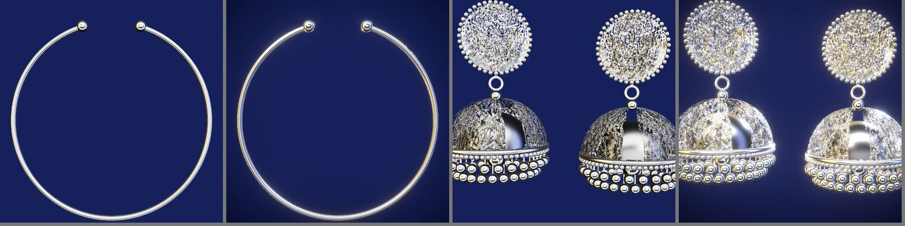<br/>
  <sub>Nira torque and Aditi jhumkas: flat render (left of each pair) vs. studio lighting, AO and bloom (right)</sub>
</p>

### 2. Scroll-driven story

- **[`StoryScene.jsx`](src/three/StoryScene.jsx)** pins a single canvas while three chapters scroll past: धातु → शिल्प → संग्रह. The chapter ground colours are painted in WebGL and blended by scroll progress.
- **[`WordPlane.jsx`](src/three/WordPlane.jsx)** renders Devanagari chapter words as 3D planes in the scene, so the jewellery can pass *through* the words.
- Text panes are plain HTML and readable at rest. The 3D is the stage, not the content.
- **[`useFrameloop.js`](src/three/useFrameloop.js)** pauses every off-screen canvas with an `IntersectionObserver`, so only visible WebGL renders.

### 3. Image pipeline

`npm run assets` runs [`scripts/prepare-assets.mjs`](scripts/prepare-assets.mjs). It turns raw photos in `assets-src/` into `public/img/`:

- resized **WebP** + **4:5 card crops** for every product and Instagram post
- **depth maps** from **Depth Anything V2**, run locally via `@huggingface/transformers`
- **normal maps** derived from depth with a Sobel filter, so a moving light can rake across the engraving
- the tray crop and logo variants (ink, ivory, mark, liquid mask)

### 4. Liquid-glass CTA

The closing pills use [liquid-glass-js](src/vendor/liquid-glass/LICENSE) (MIT), vendored in `src/vendor/liquid-glass`. They refract the velvet photography behind them.

### 5. Frame-perfect showcase recording

The video at the top was not screen-captured. It was **rendered frame by frame**:

- **[`scripts/record.mjs`](scripts/record.mjs)** runs the page on Playwright's **virtual clock**, so each frame advances time by exactly 1/60s. A scripted cursor glides, hovers, drags and clicks. Scroll follows an eased path, and CSS transitions step on the same clock. Every frame is captured, then encoded with ffmpeg. The result is perfectly smooth, however loaded the machine is.
- **[`scripts/browser-frame.mjs`](scripts/browser-frame.mjs)** renders Chrome-style window chrome and a wallpaper, then composites the recording into a rounded content mask.

---

## Tech stack

| Layer | Tools |
|---|---|
| **UI** | React 19, Vite 8 (`@vitejs/plugin-react`) |
| **3D** | Three.js r186, @react-three/fiber 9, @react-three/drei 10, three-stdlib |
| **Post-processing** | @react-three/postprocessing 3, postprocessing 6 (N8AO, Bloom, Vignette, SMAA) |
| **Effects** | liquid-glass-js (vendored, MIT), which snapshots the page with html2canvas to refract it |
| **Asset tooling** | sharp, @huggingface/transformers (Depth Anything V2) |
| **Recording** | Playwright (virtual clock), ffmpeg |
| **Fonts** | Cormorant Garamond, Anybody, Manrope, Tiro Devanagari Marathi (Google Fonts) |

---

## Project structure

```text
lajjha-landing/
├── index.html                  # fonts, meta, root
├── DESIGN.md                   # brand + design system spec
├── src/
│   ├── App.jsx                 # nav, Instagram, care, closer, footer
│   ├── data.js                 # catalogue (11 pieces) + Instagram posts
│   ├── Lab.jsx                 # dev-only single-model inspector
│   ├── styles.css              # tokens, layout, type
│   ├── components/
│   │   ├── Hero.jsx            # headline, trust row, hero canvas
│   │   ├── Story.jsx           # sticky धातु / शिल्प / संग्रह chapters
│   │   ├── Shop.jsx            # the drop, filters, bag
│   │   ├── Viewer3D.jsx        # "View in 3D" modal
│   │   └── GlassCTA.jsx        # liquid-glass pills
│   ├── three/
│   │   ├── jewellery.js        # procedural models + silver() material
│   │   ├── HeroScene.jsx       # लज्जा, orbiting torque, draggable crescent
│   │   ├── StoryScene.jsx      # scroll-driven chapters
│   │   ├── Stage.jsx           # Studio lighting + Effects
│   │   ├── WordPlane.jsx       # Devanagari in 3D
│   │   ├── pointer.js          # shared pointer state
│   │   └── useFrameloop.js     # pause off-screen canvases
│   └── vendor/liquid-glass/    # MIT, vendored
├── scripts/
│   ├── prepare-assets.mjs      # WebP, crops, depth + normal maps, logos
│   ├── prepare-textures.mjs    # engraving textures for the 3D models
│   ├── record.mjs              # frame-perfect showcase recording
│   └── browser-frame.mjs       # browser-window composite
├── assets-src/                 # raw product + Instagram photos, products.json
├── public/img/                 # generated web assets (+ depth/, normal/)
└── docs/media/                 # README screenshots + showcase video
```

---

## Getting started

```bash
npm install
npm run dev        # http://localhost:5173
npm run build      # static site in dist/ (base './', so it runs from any folder or host)
npm run preview    # serve the production build
```

### Model lab (dev only)

Inspect any procedural piece on its own, next to its photo:

```
http://localhost:5173/?m=ira#lab        # m = ira | kaveri | nira | aditi
                    &v=front|top|side|three   # camera
                    &fx=0                     # disable post-processing
```

### Adding a product photo

1. Drop the photo in `assets-src/`.
2. Add an id for it in `scripts/prepare-assets.mjs`.
3. Run `npm run assets`.
4. Reference the id in `src/data.js`.

To regenerate the engraving textures for the 3D models, run `node scripts/prepare-textures.mjs`.

### Re-recording the showcase

The recording scripts need the Playwright CLI installed globally (`npm i -g @playwright/cli`) and `ffmpeg` on your `PATH`.

```bash
npm run build && npx vite preview --host 127.0.0.1 --port 5190   # record.mjs loads http://127.0.0.1:5190/?capture
node scripts/record.mjs --fps 60 --width 1920 --height 1080
node scripts/browser-frame.mjs --in recording/lajjha-showcase-1920x1080-60fps.mp4 --url lajjha.com
```

---

<div align="center">

<sub><b>Lajjha</b> by Preeti Maurya · Siliguri → India · Est. 2019, reborn 2026</sub><br/>
<sub>हाथ से बना · हाथ से काला: made by hand, blackened by hand.</sub>

</div>
